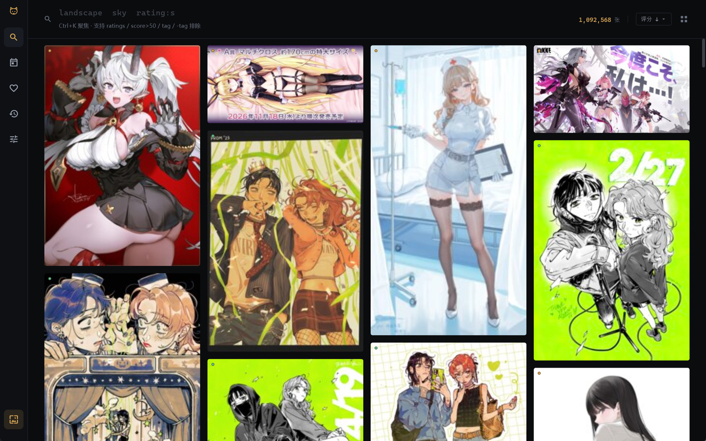
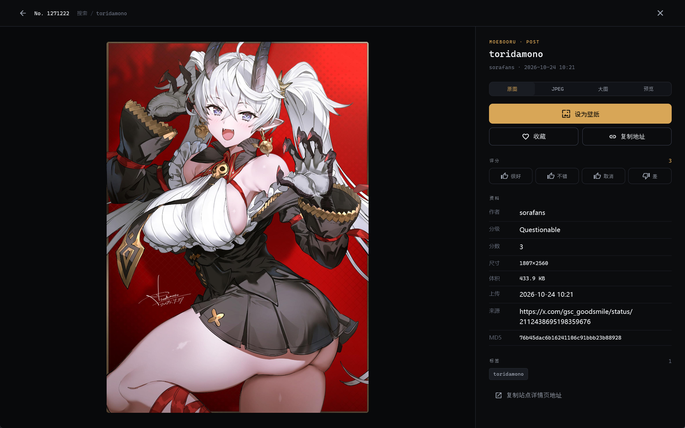
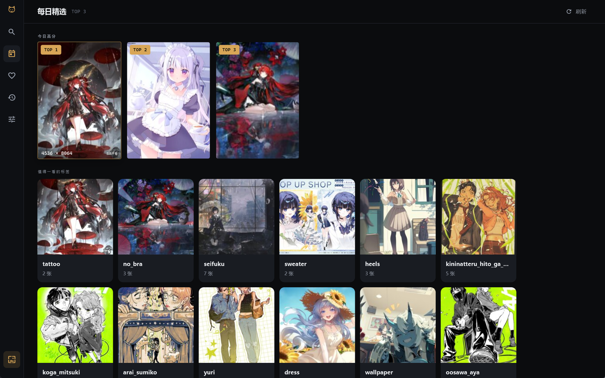
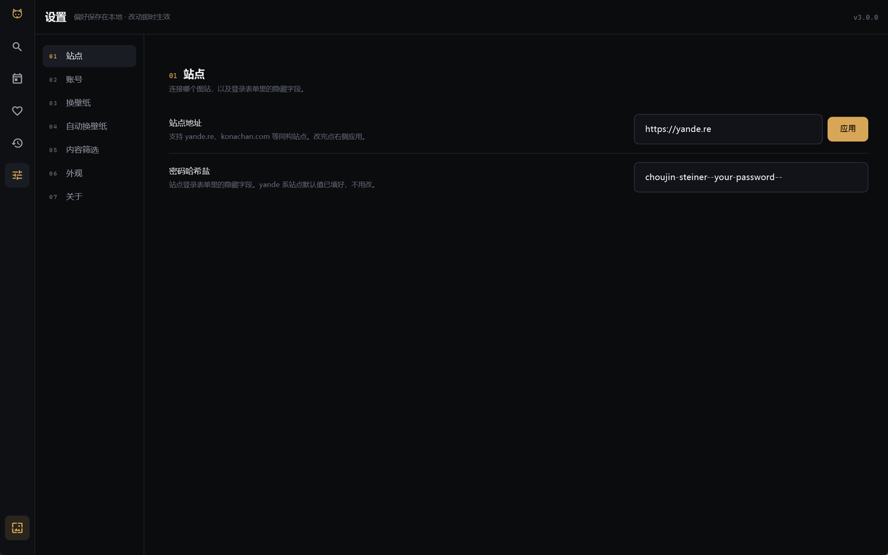
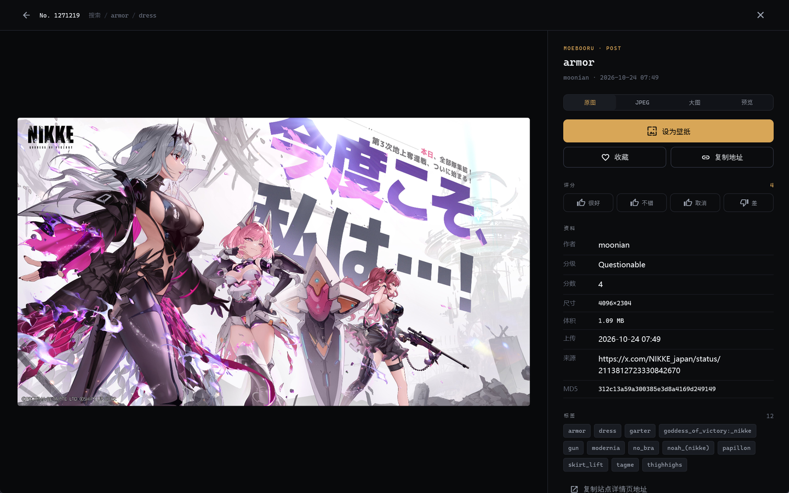
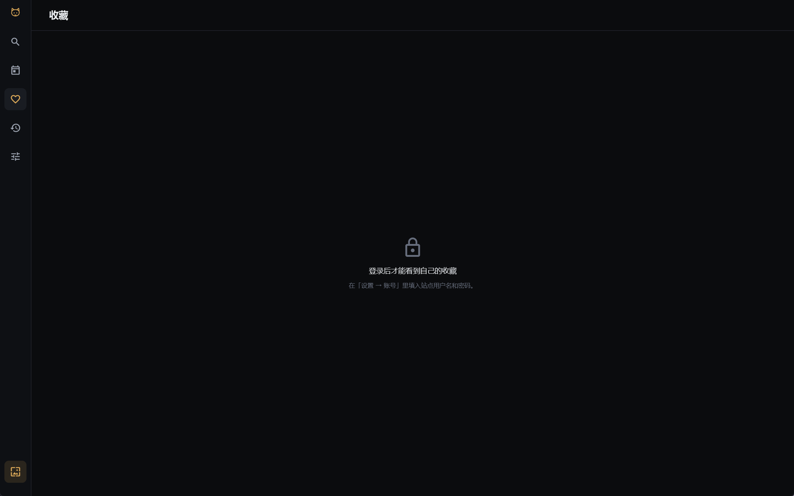
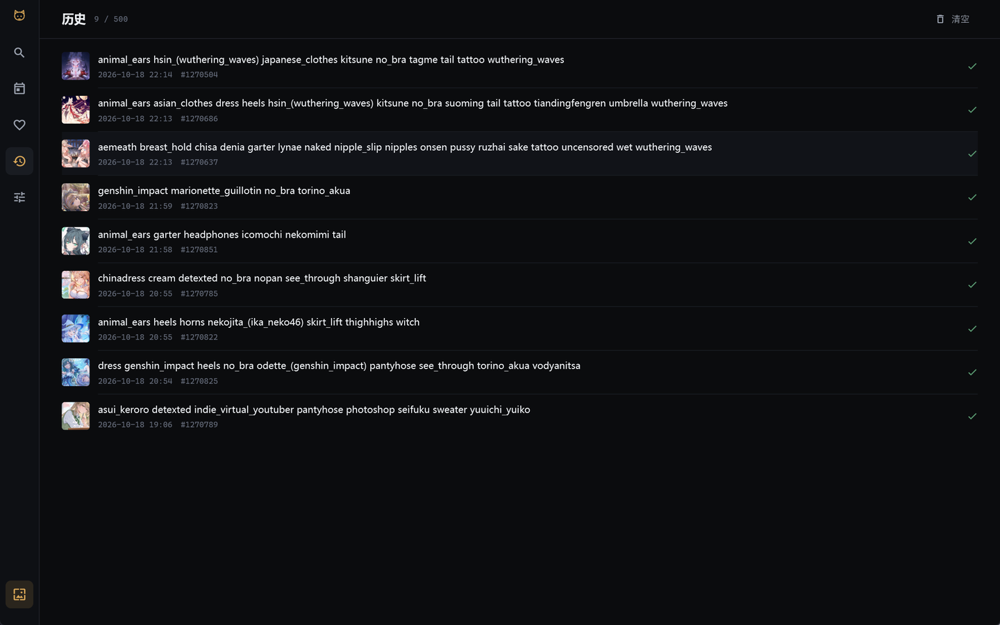

# PRPR (Flutter 重写版)

原 [`laplamgor/PRPR`](https://github.com/laplamgor/PRPR) 是一个 UWP 版的 Moebooru（yande.re / konachan）
壁纸客户端，2017 年起开发、2021 年停更，应用也已被微软从商店下架。
本仓库是它的 fork，由 shilonyin 维护；这个目录是 **Flutter 桌面重写版**。

这一版只面向 **Windows 桌面**，把原版真正被人使用的部分保留下来：

- 浏览 booru 站点（搜索、瀑布流、图片详情、评分、收藏）
- 人脸检测 + 智能裁剪（把壁纸裁到不切脸）
- 一键设置为壁纸，以及定时自动更换
- 每日精选、历史记录、内容分级筛选

## 安装到本机

不想每次都从 `build\` 目录里找 exe 的话，用附带脚本装到当前用户目录：

```powershell
cd app
powershell -ExecutionPolicy Bypass -File tool\install.ps1
```

它会做四件事：把 `build\windows\x64\runner\Release` 整个复制到
`%LOCALAPPDATA%\Programs\PRPR`、在开始菜单和桌面各建一个快捷方式、
在安装目录里留一份 `卸载.ps1`、然后启动一次。

不需要管理员权限，也不写注册表 —— 卸载就是跑那个 `卸载.ps1`（或者手动删目录 + 两个快捷方式）。
设置、下载的壁纸和历史记录在 `%APPDATA%\io.github.shilonyin\prpr`，卸载脚本**不会**删，
想彻底清干净要自己动手。

## 界面

界面按「暗色标本室」重做过一轮：近黑底、单一金色强调、等宽字体承担全部数字与标签语法。
完整的设计推导、token 表与落地记录在 [`docs/ui-redesign.md`](../docs/ui-redesign.md)。

五张主页面共用一条 56px 的纯图标导航轨（没有文字，当前项左侧一条金线），
「换一张壁纸」这个全局动作放在轨底 —— 它在任何页都可用，属于应用级动作而不是页面级动作。
全局 AppBar 已取消：各页自己画顶栏，因为搜索页真正需要常驻顶栏的是**搜索语法本身**。

搜索页。顶栏里嵌着无边框的等宽查询（金色光标 + 一行语法提示），滚动瀑布流时不跟着滚走。
列数由窗口宽度现算，密度按钮只决定单张图的目标宽度 —— 4K 屏拉宽会自然变成 6–7 列，
而不是把 4 张图各撑到 600px。瓦片左上角 6px 圆点是分级（绿 safe / 金 questionable / 红 explicit）。



帖子详情。顶栏是返回箭头 + `No. 1271220` + 面包屑；左侧深色画布居中放图，
右侧固定 440px：kicker、标题、画质四段、全宽金色「设为壁纸」、收藏/复制、评分四档、
资料六行、标签 chips。



每日精选。TOP 3 横排卡片（金/灰排名徽章）+ 「值得一看的标签」封面墙。



设置页。左侧 176px 编号导航（`01 站点` … `07 关于`），右侧是无卡片的行式列表，
每行左标签/说明 + 右侧控件，行间 1px 分隔 —— 不再有「每段一张卡片、整页限宽 880」。



关于页。应用图标是金色圆角底 + 深色猫脸，与导轨顶部那只 1.4px 金线猫头同源。



收藏页与历史页：





## 交互动效

动效不是装饰，是一套有数字的约定。所有时长与曲线都在 `lib/ui/theme.dart` 的 `AppTheme` 里：

| token | 值 | 用途 |
| --- | --- | --- |
| `durMicro` | 90ms | 按下 / 抬起 |
| `durFast` | 140ms | 图标、遮罩、chip |
| `durBase` | 180ms | 切页内容、标题 |
| `durMed` | 220ms | 图片渐显、侧栏、状态切换 |
| `durSlow` | 260ms | 页面转场、换画质、列表新行 |
| `durTask` | 400ms | 长任务分段进度 |

曲线只有三条：`curveIn = easeOutCubic`、`curveOut = easeInCubic`、`curveEmph = easeInOutCubic`。
超过 240ms 的微交互不用；回弹全应用只允许两处（换壁纸成功胶囊、收藏心跳）。

几个刻意做成这样的地方：

- **换壁纸的反馈在导航轨底部那个 40×40 的位置上**：三种状态（金色描边图标 /
  分段进度环 / 绿色勾）共用一个位置，用户第二次点的时候手不用重新找。
  环按阶段分 5 段而不是画百分比 —— 各阶段耗时从 200ms 到 3s 不等，画百分比只会骗人。
- **首屏是骨架网格**，并且只有一个 `AnimationController` 驱动全部占位块 ——
  每张卡各转一个进度圈意味着同屏 30 个 ticker。骨架与真内容共用
  `PostGrid.columnsFor` 同一套列宽公式，否则首屏画 5 列、数据到了变 4 列会横跳一次。
- **成功类操作不弹提示条**：设置项在右上角闪「已保存」，复制/收藏/投票把图标临时换成勾，
  只有失败才用 `AppToast.error`，而它会先 `hideCurrentSnackBar`，不会堆叠。
- **切页不做整页重建**：保留 `IndexedStack`（否则搜索词、滚动位置、焦点全丢），
  只在外面套一次性淡入 + 8px 上浮。
- **侧栏不再折叠**：56px 纯图标轨常驻，比「236 ↔ 80 展开收起」少一次动画、
  也多出 180px 给图片。`NavigationRail` 的 `extended` 切换会在一帧内改宽度和布局，
  任何补间都盖不住 —— 干脆不做这个动作。

长时间操作不在 UI isolate 上跑：设置壁纸（win32 FFI + 注册表）和人脸检测（OpenCV 级联）
都通过 `Isolate.run` 放到后台，否则进度指示器自己就在掉帧。

键盘：`Ctrl+1..5` 切页、`Ctrl+K` 聚焦搜索、`Ctrl+Enter` 换壁纸、`F5`/`Ctrl+R` 刷新、
`Esc` 返回；瓦片支持 Tab 聚焦 + 方向键 + Enter。

## 运行要求

| 依赖 | 版本 | 说明 |
| --- | --- | --- |
| Flutter | 3.47.x（Dart 3.13） | 更低版本没有用到的 Dart 3.13 语法 |
| CMake | 3.22 以上，**必须在 PATH 里** | `opencv_dart` 通过 native assets hook 构建 C++ 扩展，缺 CMake 会直接构建失败 |
| Visual Studio | 2019/2022，需装「使用 C++ 的桌面开发」 | 同上，CMake 需要一个 MSVC 工具链 |
| Ninja | 随 CMake 或 Android SDK 附带 | native assets 默认生成器 |

如果 `cmake --version` 报「不是内部或外部命令」，任何 `flutter test` / `flutter build` 都会在
`Building native assets failed` 处停住。把 CMake 的 `bin` 目录加进 PATH 即可，例如：

```powershell
$env:PATH = 'C:\tools\cmake\bin;' + $env:PATH
```

## 构建与运行

```powershell
cd app
flutter pub get
flutter analyze      # 应为 No issues found
flutter test         # 纯逻辑单元测试，不联网
flutter run -d windows
```

发布构建：

```powershell
flutter build windows --release
# 产物在 build\windows\x64\runner\Release\PRPR.exe
```

## 三个会浪费你半天的构建坑

**1. CMake 必须在 PATH 里，且版本串必须干净。**
Android SDK 里那份 CMake（`…\Android\Sdk\cmake\3.22.1\bin\cmake.exe`）的版本号是
`3.22.1-g37088a8-dirty`，Flutter 解析不了这个后缀，会报
`Unknown version for ToolInstance(CMake, …)` 然后 `Failed to find cmake with version=latest`。
**把它加进 PATH 也没用。** 装一份干净的官方 CMake，例如便携版解压到 `C:\tools\cmake`，
再把 `C:\tools\cmake\bin` 放到 PATH 最前面。（`tool/build.ps1` 会自动做这件事。）

**2. `dartcv4` 默认不编译 `objdetect`，而人脸检测正需要它。**
`dartcv4` 的默认模块集合是 `core + imgcodecs + imgproc`，
`CascadeClassifier` 属于 `objdetect`，不显式声明就会**编译通过、运行时才炸**。
`pubspec.yaml` 里的 `hooks.user_defines.dartcv4.include_modules` 就是干这个的，
特别注意它**是整体替换而不是追加**，所以三个模块必须写全：

```yaml
hooks:
  user_defines:
    dartcv4:
      include_modules: [imgcodecs, imgproc, objdetect]
```

别顺手把 `dnn` / `video` / `highgui` 也加进来，首次构建会从十几分钟涨到一小时以上。
首次 `flutter test` 和首次 `flutter build windows --release` 会各自编译一遍 OpenCV，
之后走 `.dart_tool\hooks_runner` 缓存。

**3. MSVC 把中文注释当成编译错误。**
中文 Windows 上 MSVC 按代码页 936 读源码，UTF-8 的中文注释会触发 `warning C4819`；
而 Flutter 的 `apply_standard_settings` 给 runner 开了 `/WX`，警告直接变成
`error C2220`。`windows/runner/CMakeLists.txt` 里显式加了 `/utf-8` 来解决。
如果你用 `flutter create` 重新生成过 `windows/` 目录，这一行会丢，需要重新补上。

## 代码结构

```
lib/
  models/     纯数据模型：Post / Tag / PostFilter / PostsPage
  services/   无 UI 的逻辑：站点客户端、裁剪算法、人脸检测、壁纸、设置、历史
  ui/         界面层：theme / app_state / widgets / pages
```

`models` 与 `services` 刻意不 import Flutter Widget 层，所以能被 `flutter test` 直接覆盖
（见 `test/prpr_test.dart`）。界面层只读 `AppState`，不自己发网络请求。

## 数据存放位置

| 内容 | 位置 |
| --- | --- |
| 设置（站点、账号、筛选、主题…） | `%APPDATA%\io.github.shilonyin\prpr\shared_preferences.json` |
| 下载并裁剪过的壁纸 | `…\prpr\wallpapers\` |
| 历史记录 | `…\prpr\wallpaper_history.json` |
| 人脸级联文件 | `…\prpr\lbpcascade_animeface.xml`（首次运行从 assets 释放） |

具体根目录由 `path_provider` 的 `getApplicationSupportDirectory()` 决定。

## 图标

图标不用位图拼贴，而是用 Pillow 直接画：金色圆角底（`AppPalette.dark.gold` = `#D8A657`）
配深色猫脸（`AppPalette.dark.onGold` = `#14110A`），猫脸的路径与导轨顶部
`ui/widgets/app_rail.dart` 里 `_CatPainter` 用的那条贝塞尔曲线同源——同一只猫，
只是导轨上是 1.4px 金线，图标里是实心。

> 早先的版本沿用 UWP 的白猫剪影（`PRPR/Assets/Square44x44Logo…png`）垫靛蓝底板。
> 强调色换成金色之后，蓝紫图标与金色标题栏是两套视觉，所以整段重画。

**每个尺寸单独绘制，而不是从 512 缩下来。** 16px 若按大图比例缩放，线条只剩 0.6px，
LANCZOS 平均后会变成一圈灰边，整只猫糊成方块。所以 `render(size)` 先以 8 倍尺寸画，
线宽与脸的尺度按档位补偿（≤24px 线更粗、脸更小），再缩回目标尺寸，等于自带超采样。
耳朵用实心三角而非描边三角——描边三角的根部会和脸留下缝隙，小尺寸下同样糊。

脚本同时产出两样东西：`app/assets/app_logo.png`（512，关于页用）与
`app/windows/runner/resources/app_icon.ico`（9 个尺寸：16/20/24/32/40/48/64/128/256，
exe / 任务栏 / 快捷方式读它）。改配色或改形状之后重跑一次即可：

```
python app/tool/make_icon.py
```

## 已知限制

- **不支持设置锁屏壁纸。** Win32 桌面没有稳定的锁屏壁纸接口
  （UWP 的 `UserProfilePersonalizationSettings` 只在 AppContainer 里可用），
  代码里显式返回「尚未实现」而不是静默失败。
- **不移植开始菜单磁贴。** Windows 11 已经移除磁贴，原版的 `SetTileAsync` 没有意义。
- **历史记录改用 JSON 文件**（原来是 EF Core + SQLite），数据量很小，不值得为此背一个平台插件和迁移维护成本。
- 自动更换壁纸只在程序运行期间生效，**没有后台常驻服务**。
- **请求 12 秒超时。** 见 `YandeClient.timeout`。直连被墙站点时 TCP 握手默认无限等，
  界面会一直转圈；超时后显示可重试的错误页而不是无限加载。
- **代理只认系统设置，不认 PAC 脚本。** Dart 的 `HttpClient` 原生只读 `HTTP_PROXY` 这类环境变量，
  完全不看 Windows「设置 → 网络和 Internet → 代理」。双击快捷方式启动时环境变量是空的，
  所以 `lib/services/system_proxy.dart` 会去读注册表里的 `ProxyEnable` / `ProxyServer`
  并接管所有 `HttpClient`。若你的代理只在 PAC（`AutoConfigURL`）里配，这里读不到，
  需要改成手动填服务器地址，或者用环境变量启动。
- **无障碍（屏幕阅读器）被刻意关闭。** Flutter 引擎在 `accessibility_bridge.cc:229` 有个空指针
  崩溃：只要系统里有 UIA 客户端（PowerToys 的 PowerOCR / QuickAccess、屏幕阅读器、自动化或
  截图工具）查询过本窗口，引擎就会启用无障碍树，随后在语义树重挂时空指针解引用，
  release 构建里 `assert` 被编掉，整个进程直接消失（退出码 `0xC0000005`，出错模块
  `flutter_windows.dll`）。上游 issue：
  [flutter/flutter#175041](https://github.com/flutter/flutter/issues/175041)，3.24.5～3.47.7 均可复现。
  规避方式是在 `windows/runner/flutter_window.cpp` 里给 `FLUTTERVIEW` 子窗口挂子类过程，
  把 `WM_GETOBJECT` 一律回 0，引擎就不会建无障碍树。**代价是屏幕阅读器读不到应用内容** ——
  对图片壁纸工具是可接受的取舍。引擎修好后删掉那段子类化即可。
  完整排查过程（符号化栈、A/B 对照、为什么必须拦子窗口）见根目录 `MIGRATION.md`。
