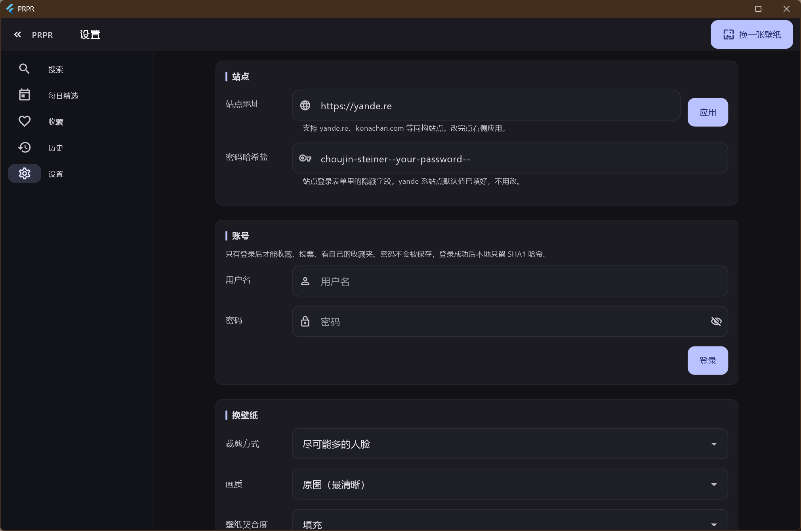

# PRPR (Flutter 重写版)

原 `shilonyin/PRPR` 是一个 UWP 版的 Moebooru（yande.re / konachan）壁纸客户端。
应用被微软从商店下架、上游停更近五年之后，这个目录是它的 **Flutter 桌面重写版**。

这一版只面向 **Windows 桌面**，把原版真正被人使用的部分保留下来：

- 浏览 booru 站点（搜索、瀑布流、图片详情、评分、收藏）
- 人脸检测 + 智能裁剪（把壁纸裁到不切脸）
- 一键设置为壁纸，以及定时自动更换
- 每日精选、历史记录、内容分级筛选

## 安装到本机

不想每次都从 `build\` 目录里找 exe 的话，用附带脚本装到当前用户目录：

```powershell
cd app
powershell -ExecutionPolicy Bypass -File tool\install.ps1
```

它会做四件事：把 `build\windows\x64\runner\Release` 整个复制到
`%LOCALAPPDATA%\Programs\PRPR`、在开始菜单和桌面各建一个快捷方式、
在安装目录里留一份 `卸载.ps1`、然后启动一次。

不需要管理员权限，也不写注册表 —— 卸载就是跑那个 `卸载.ps1`（或者手动删目录 + 两个快捷方式）。
设置、下载的壁纸和历史记录在 `%APPDATA%\io.github.shilonyin\prpr`，卸载脚本**不会**删，
想彻底清干净要自己动手。

## 界面




## 运行要求

| 依赖 | 版本 | 说明 |
| --- | --- | --- |
| Flutter | 3.47.x（Dart 3.13） | 更低版本没有用到的 Dart 3.13 语法 |
| CMake | 3.22 以上，**必须在 PATH 里** | `opencv_dart` 通过 native assets hook 构建 C++ 扩展，缺 CMake 会直接构建失败 |
| Visual Studio | 2019/2022，需装「使用 C++ 的桌面开发」 | 同上，CMake 需要一个 MSVC 工具链 |
| Ninja | 随 CMake 或 Android SDK 附带 | native assets 默认生成器 |

如果 `cmake --version` 报「不是内部或外部命令」，任何 `flutter test` / `flutter build` 都会在
`Building native assets failed` 处停住。把 CMake 的 `bin` 目录加进 PATH 即可，例如：

```powershell
$env:PATH = 'C:\tools\cmake\bin;' + $env:PATH
```

## 构建与运行

```powershell
cd app
flutter pub get
flutter analyze      # 应为 No issues found
flutter test         # 纯逻辑单元测试，不联网
flutter run -d windows
```

发布构建：

```powershell
flutter build windows --release
# 产物在 build\windows\x64\runner\Release\PRPR.exe
```

## 三个会浪费你半天的构建坑

**1. CMake 必须在 PATH 里，且版本串必须干净。**
Android SDK 里那份 CMake（`…\Android\Sdk\cmake\3.22.1\bin\cmake.exe`）的版本号是
`3.22.1-g37088a8-dirty`，Flutter 解析不了这个后缀，会报
`Unknown version for ToolInstance(CMake, …)` 然后 `Failed to find cmake with version=latest`。
**把它加进 PATH 也没用。** 装一份干净的官方 CMake，例如便携版解压到 `C:\tools\cmake`，
再把 `C:\tools\cmake\bin` 放到 PATH 最前面。（`tool/build.ps1` 会自动做这件事。）

**2. `dartcv4` 默认不编译 `objdetect`，而人脸检测正需要它。**
`dartcv4` 的默认模块集合是 `core + imgcodecs + imgproc`，
`CascadeClassifier` 属于 `objdetect`，不显式声明就会**编译通过、运行时才炸**。
`pubspec.yaml` 里的 `hooks.user_defines.dartcv4.include_modules` 就是干这个的，
特别注意它**是整体替换而不是追加**，所以三个模块必须写全：

```yaml
hooks:
  user_defines:
    dartcv4:
      include_modules: [imgcodecs, imgproc, objdetect]
```

别顺手把 `dnn` / `video` / `highgui` 也加进来，首次构建会从十几分钟涨到一小时以上。
首次 `flutter test` 和首次 `flutter build windows --release` 会各自编译一遍 OpenCV，
之后走 `.dart_tool\hooks_runner` 缓存。

**3. MSVC 把中文注释当成编译错误。**
中文 Windows 上 MSVC 按代码页 936 读源码，UTF-8 的中文注释会触发 `warning C4819`；
而 Flutter 的 `apply_standard_settings` 给 runner 开了 `/WX`，警告直接变成
`error C2220`。`windows/runner/CMakeLists.txt` 里显式加了 `/utf-8` 来解决。
如果你用 `flutter create` 重新生成过 `windows/` 目录，这一行会丢，需要重新补上。

## 代码结构

```
lib/
  models/     纯数据模型：Post / Tag / PostFilter / PostsPage
  services/   无 UI 的逻辑：站点客户端、裁剪算法、人脸检测、壁纸、设置、历史
  ui/         界面层：theme / app_state / widgets / pages
```

`models` 与 `services` 刻意不 import Flutter Widget 层，所以能被 `flutter test` 直接覆盖
（见 `test/prpr_test.dart`）。界面层只读 `AppState`，不自己发网络请求。

## 数据存放位置

| 内容 | 位置 |
| --- | --- |
| 设置（站点、账号、筛选、主题…） | `%APPDATA%\io.github.shilonyin\prpr\shared_preferences.json` |
| 下载并裁剪过的壁纸 | `…\prpr\wallpapers\` |
| 历史记录 | `…\prpr\wallpaper_history.json` |
| 人脸级联文件 | `…\prpr\lbpcascade_animeface.xml`（首次运行从 assets 释放） |

具体根目录由 `path_provider` 的 `getApplicationSupportDirectory()` 决定。

## 已知限制

- **不支持设置锁屏壁纸。** Win32 桌面没有稳定的锁屏壁纸接口
  （UWP 的 `UserProfilePersonalizationSettings` 只在 AppContainer 里可用），
  代码里显式返回「尚未实现」而不是静默失败。
- **不移植开始菜单磁贴。** Windows 11 已经移除磁贴，原版的 `SetTileAsync` 没有意义。
- **历史记录改用 JSON 文件**（原来是 EF Core + SQLite），数据量很小，不值得为此背一个平台插件和迁移维护成本。
- 自动更换壁纸只在程序运行期间生效，**没有后台常驻服务**。
- **请求 12 秒超时。** 见 `YandeClient.timeout`。直连被墙站点时 TCP 握手默认无限等，
  界面会一直转圈；超时后显示可重试的错误页而不是无限加载。
- **代理只认系统设置，不认 PAC 脚本。** Dart 的 `HttpClient` 原生只读 `HTTP_PROXY` 这类环境变量，
  完全不看 Windows「设置 → 网络和 Internet → 代理」。双击快捷方式启动时环境变量是空的，
  所以 `lib/services/system_proxy.dart` 会去读注册表里的 `ProxyEnable` / `ProxyServer`
  并接管所有 `HttpClient`。若你的代理只在 PAC（`AutoConfigURL`）里配，这里读不到，
  需要改成手动填服务器地址，或者用环境变量启动。
- **Windows 无障碍（屏幕阅读器）是一条已知的引擎崩溃路径。** 系统里只要有 UIA 客户端
  （PowerToys 的 PowerOCR / QuickAccess、屏幕阅读器、自动化或截图工具）查询过本窗口，
  Flutter 引擎就会启用无障碍树；引擎在 `accessibility_bridge.cc:229` 处会解引用空指针，
  release 构建里 `assert` 被编掉，于是直接崩掉整个进程（退出码 `0xC0000005`）。
  上游 issue：[flutter/flutter#175041](https://github.com/flutter/flutter/issues/175041)，
  3.24.5～3.47.4 均可复现，本机比对过 3.47.7 与 master，**该函数一字未改**。
  当前界面恰好不触发（连跑 10+ 次未复现），但那是绕开而不是修好；
  完整排查过程（含符号化栈与对照实验）见根目录 `MIGRATION.md`。
